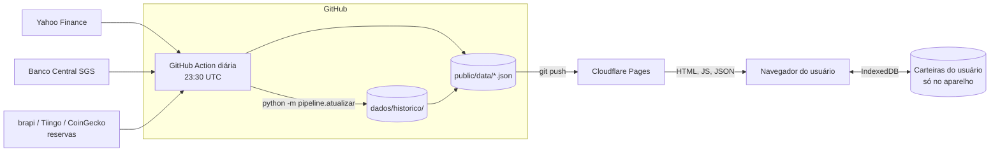

# Arquitetura



## Peças

| Peça | Onde | O que faz |
|---|---|---|
| Histórico | `dados/historico/precos_mensais.csv`, `simulador.json` | Meses fechados. Fonte da verdade. Só cresce. |
| Pipeline | `pipeline/` (Python) | Busca preços diários desde o último mês fechado, estende as séries, checa, grava. |
| Agendador | `.github/workflows/atualizar-dados.yml` | Roda o pipeline todo dia e faz commit de `public/data` e do histórico. |
| Site | `public/` | HTML, CSS e JS sem build. Lê `/data/*.json`. |
| Hospedagem | Cloudflare Pages | Publica `public/` a cada push na branch principal. Aplica `public/_headers`. |
| Carteiras | IndexedDB do navegador | Guardadas pelo `carteira-armazenamento.js`. Nunca vão para o servidor. |

## Por que assim

- **Sem servidor de aplicação.** O site é só arquivo estático: barato (plano grátis do
  Cloudflare), rápido e sem lugar para guardar dado de usuário. É o que garante a privacidade.
- **Cálculo no navegador.** `dados.js` deriva base 100, retornos e risco a partir dos preços
  mensais. As janelas (5, 10, 15 anos) andam sozinhas quando entra um mês novo.
- **Pipeline em Python no GitHub Actions.** Grátis, com histórico de execuções e e-mail
  automático quando falha. Cada atualização vira um commit: dá para auditar e reverter.

## Arquivos de dados (contrato)

`public/data/mercado.json`
```json
{
  "versao": 1,
  "atualizado_em": "2026-11-04T23:41:07+00:00",
  "data_ref": "2026-11-04",
  "ultimo_mes": "2026-11",
  "parcial": true,
  "meses": ["2004-08", "...", "2026-11"],
  "usdbrl": [2.9338, "...", 5.03],
  "ativos": [
    {"id": "ITUB3", "nome": "Itaú ON", "tipo": "acao", "mercado": "Brasil", "moeda": "BRL",
     "inicio": "2004-08", "precos": [1.0483, "..."]}
  ]
}
```
- `precos` está alinhado a `meses` a partir de `inicio`, na moeda do ativo, ajustado por proventos.
- O CDI aparece como ativo (`"id": "CDI"`): um índice em reais.
- `usdbrl` é a PTAX de venda do fim de cada mês (ou do último dia útil, no mês parcial).

`public/data/simulador.json`: `months`, `fx` (variação mensal do dólar) e uma lista de
retornos mensais em reais para cada categoria (`rfbr`, `rfex`, `rvbr`, `rvex`, `ouro`, `alt`).

`public/data/status.json`: data dos dados, se o mês é parcial, fonte usada por ativo.

Mudança incompatível nesses arquivos exige subir `versao` e ajustar as páginas no mesmo commit.

## Front-end

- `assets/js/dados.js`: carrega e deriva tabelas (testado contra o cálculo original).
- `assets/js/dash-shim.js`: imita a API do painel original (`dash.data`, `dash.draw`...), para
  reaproveitar o código de desenho do comparador.
- `assets/js/config-ativos.js`: cores, rótulos, traços e grupos.
- `assets/js/carteira-*.js`: modelo, motor de risco, armazenamento e backup cifrado.
- Bibliotecas: D3 7.9.0 (comparador) e Chart.js 4.4.1 (simulador e carteira), em `assets/vendor/`.
